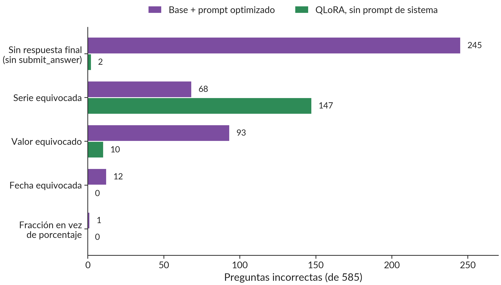
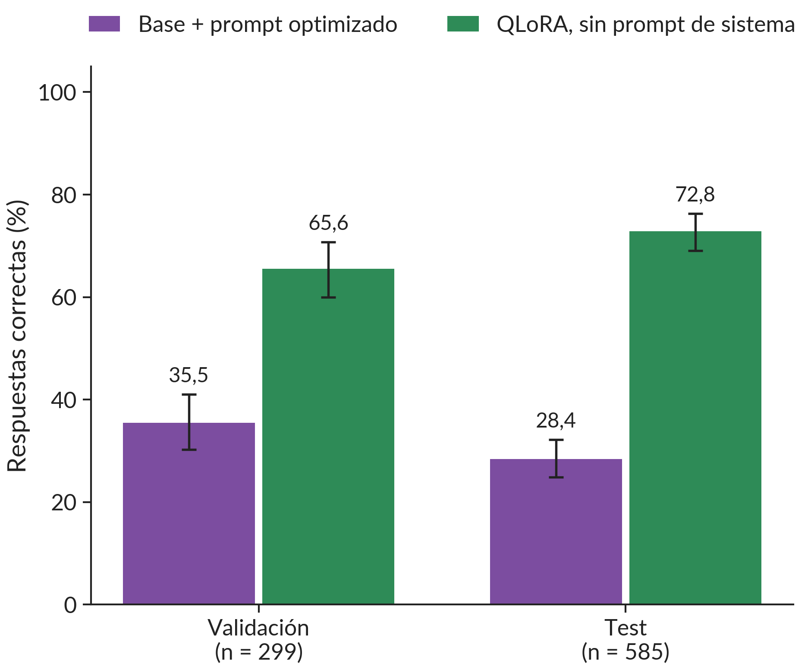
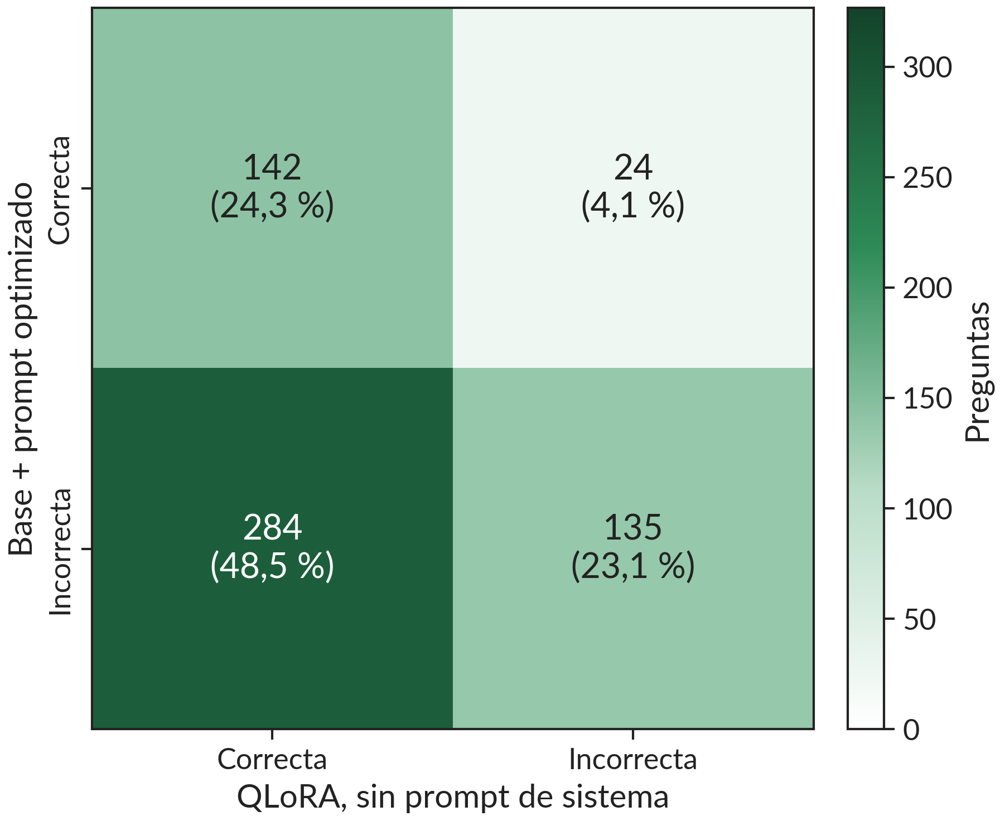

# series-ar-qlora

Agente que responde preguntas en lenguaje natural sobre series de tiempo oficiales de Argentina
([API de Series de Tiempo de datos.gob.ar](https://datos.gob.ar/series/api)) usando tres herramientas
(`search_series`, `get_series`, `submit_answer`). El proyecto ajusta con **QLoRA** un modelo chico
(Qwen3-4B-Instruct, cuantizado a 4 bits) y lo compara contra el mismo modelo sin ajustar, con un
evaluador propio y una partición de datos que evita fuga entre entrenamiento y prueba.

> **Estado:** en preparación. Las secciones marcadas como _pendiente_ se completan cuando se
> regeneran las tablas y figuras desde los resultados reales (`results/`, `figures/`).


## Resultado principal

Evaluación en **test**: 585 preguntas técnicas de 23 familias de datasets que no aparecen en el entrenamiento.
Una corrida por modelo, decodificación determinista. Salida completa en `results/comparacion_test.txt`.

| | Base + prompt optimizado | QLoRA, sin prompt de sistema |
|---|---|---|
| Respuestas correctas | 166 / 585 = **28,4 %** (Wilson 25–32 %) | 426 / 585 = **72,8 %** (Wilson 69–76 %) |
| Terminó con `submit_answer` | 58 % | 99,7 % |
| Serie correcta (última consultada) | 76 % | 75 % |
| Segundos por pregunta | 10,2 | 8,5 |

- **Diferencia: +44,4 puntos.** Intervalo del 95 % agrupado por familias (bootstrap, 10.000 remuestreos): **+37,2 a +51,9**.
  El modelo ajustado supera al base en las 23 familias.
- **Emparejado:** ambas correctas 142 · solo el ajustado 284 · solo el base 24 · ninguna 135.

| Tipo de pregunta | n | Base | QLoRA |
|---|---|---|---|
| Sin datos (la API no tiene el dato) | 164 | 12 % | 77 % |
| Último dato | 147 | 28 % | 74 % |
| Valor puntual | 146 | 49 % | 70 % |
| Variación interanual | 128 | 27 % | 69 % |

| Causa de fallo | Base | QLoRA |
|---|---|---|
| No terminó con `submit_answer` | 245 | 2 |
| Valor equivocado | 93 | 10 |
| Fecha equivocada | 12 | 0 |
| Fracción en vez de porcentaje | 1 | 0 |
| Serie equivocada | 68 | 147 |

Validación (n = 299): 35,5 % contra 65,6 % _(verificado contra la salida de los notebooks de evaluación)_.

### Figuras


**Figura 1.** Porcentaje de respuestas correctas en test (n = 585), en total y por tipo de pregunta. Barras violeta: modelo base con prompt optimizado; barras verdes: modelo ajustado con QLoRA, sin prompt de sistema. Barras de error: intervalo de confianza del 95 % de Wilson, que supone preguntas independientes. Diferencia total entre modelos: +44,4 puntos; IC del 95 % remuestreando las 23 familias de datasets (10.000 réplicas): +37,2 a +51,9. _Se muestra la versión animada; los mismos valores están en [PNG](figures/fig1_exactitud_por_tipo.png) y [PDF](figures/fig1_exactitud_por_tipo.pdf)._



**Figura 2.** Causa de fallo de las preguntas incorrectas en test (n = 585). Cada pregunta incorrecta se asigna a su primera causa, en este orden: no terminó con `submit_answer`, serie equivocada, valor equivocado y fecha equivocada. Dentro de valor equivocado se cuenta aparte el caso en que el valor es correcto expresado como fracción en vez de porcentaje.



**Figura 3.** Porcentaje de respuestas correctas en validación (n = 299) y en test (n = 585). Barras de error: IC del 95 % de Wilson. Los niveles no son comparables entre conjuntos, porque contienen familias de datasets distintas.


**Figura 4.** Pérdida durante el entrenamiento QLoRA (1 época, 100 pasos), copiada del registro de la corrida. La pérdida de entrenamiento se registra cada 10 pasos; la de control, solo en los pasos 50 y 100, sobre 3 familias de datasets apartadas. _Versión animada; estática en [PNG](figures/fig4_curva_de_perdida.png) y [PDF](figures/fig4_curva_de_perdida.pdf)._



**Figura 5.** Tabla de contingencia emparejada en test (n = 585): cada pregunta según si la respondió correctamente el modelo base (filas) y el modelo ajustado (columnas). Ambas correctas: 142; solo el base: 24; solo el ajustado: 284; ninguna: 135.

### Qué mejoró y qué no

- **Mejoró el procedimiento.** El base no entrega una respuesta con `submit_answer` en el 42 % de las preguntas (245 de 585)
  y, entre las que entrega, se equivoca en el valor 93 veces (el ajustado, 10). Sobre las preguntas terminadas, el base acierta
  49 % (166 de 340) y el ajustado 73 % (426 de 583). Es un indicador, no una comparación limpia: las terminadas no son una muestra aleatoria.
- **No mejoró la elección de la serie.** En ambos modelos la serie correcta está entre los 10 candidatos del último `search_series` en
  ~90 % de los casos y, cuando está, la eligen el 83 %. En los casos en que la correcta no es el primer candidato (más de la mitad de las preguntas)
  eligen la correcta el 75–77 % y se quedan con el primer candidato solo el 10–12 %: no hay un atajo de "elegir el primero".
- **Hay un techo en la recuperación.** En 8–10 % de las preguntas la serie correcta no aparece entre los candidatos del último
  `search_series` (con la consulta que formula el modelo): ahí el agente no puede acertar. Es el punto con más margen de mejora
  (consulta construida desde la pregunta, embeddings).
- **El formato del porcentaje no es un problema:** aceptar también la fracción mueve la exactitud menos de un punto en ambos modelos.

## Limitaciones (leer antes de interpretar el resultado)

- **Una sola semilla de entrenamiento y una sola corrida por modelo.** No hay estimación de la variación entre semillas.
- **Comparación asimétrica:** el modelo base recibe un prompt de sistema diseñado con ejemplos de train; el ajustado, ninguno. Sigue pendiente el control con un prompt más fuerte y con un modelo mayor como agente.
- **El evaluador mira solo la última consulta a `get_series`** para decidir si la serie es la correcta; un agente que consulta varias series y responde con una anterior puede ser mal puntuado.
- **Preguntas generadas con un LLM** (Claude Haiku 5.5) y verificadas con otro paso del mismo modelo; no hay revisión humana exhaustiva. Las preguntas coloquiales no se evaluaron sobre test.
- **Datos acotados a un recorte del catálogo** (series con datos usables y particionadas por familias de datasets); no es una evaluación sobre todo el portal.
- Se excluyen de la evaluación las variaciones interanuales sobre tasas (ambiguas entre puntos porcentuales y porcentaje).

## Cómo está armado

```
src/series_qlora/   texto · herramientas (buscador FTS5 + caché de API) · evaluador · agente · corrida · modelo · observabilidad
                    particion (familias de datasets) · esquema · trayectorias · entrenamiento · graficos
                    cache_api · especificaciones · preguntas (construcción y filtrado de las preguntas) · graficos_animados
scripts/            evaluar.py (requiere GPU) · particionar.py · construir_trayectorias.py · entrenar.py
                    preparar_preguntas.py (pasos 2 y 3 llaman a la API de Anthropic, con costo) · figuras_animadas.py
tests/              126 tests con datos sintéticos (sin GPU, sin red)
docs/               guía de métricas, guía de entrenamiento, decisiones, errores corregidos, uso de la API de Anthropic, datos y licencias, hoja de ruta
figures/            figuras del resultado (PNG y PDF) y sus pies
notebooks/          notebooks de Colab 00 a 09 (sin salidas), con su celda inicial; ver notebooks/README.md
data/ results/      datos y salidas de las corridas; fuera del repositorio (.gitignore)
```

Piezas principales:

- **Buscador:** SQLite FTS5 con ranking bm25 (título pesa el doble que la distribución) y búsqueda por prefijo de 5 caracteres.
- **Caché de la API:** `get_series` consulta primero una caché SQLite cuya clave son los parámetros normalizados, de modo que las corridas son reproducibles.
- **Agente sin framework:** bucle de hasta 6 pasos con formato de llamadas de Qwen3 (`<tool_call>`), decodificación determinista.
- **Evaluador:** una respuesta es correcta si termina con `submit_answer`, la última serie consultada es la objetivo, el valor coincide con tolerancia y la fecha coincide al nivel de la frecuencia. Se validó con un agente oráculo (100 %) y con controles negativos (~0 %); los tests lo cubren.
- **Observabilidad:** trazas y scores en Langfuse (opcional, detrás de una interfaz de trazador).

## Reproducir

Entorno local con [uv](https://docs.astral.sh/uv/), desde la carpeta del repositorio:

```bash
uv sync                     # crea .venv con las versiones de uv.lock
uv run pytest               # sin GPU
uv run ruff check
```

Partición por familias (verifica contra la partición publicada; los datos viven fuera del repositorio):

```bash
uv run python scripts/particionar.py --datos data --catalogo catalogo_busqueda_antes_tc.csv --verificar
```

Evaluación (GPU T4, Colab; los datos viven fuera del repositorio):

```bash
pip install -r requirements-colab.txt     # en Colab se usa pip
export SERIES_QLORA_DATA=/ruta/a/los/datos
python scripts/evaluar.py --corrida entrenado --split test --langfuse
```

Trayectorias de entrenamiento y separación de control (sin GPU ni API; reproducen el conjunto usado para entrenar):

```bash
uv run python scripts/construir_trayectorias.py --datos data --solo-armar --comparar trayectorias_train_v1.jsonl
uv run python scripts/entrenar.py --datos data --modo datos
```

La partición se publicó sobre el catálogo anterior al dataset de tipo de cambio (8.209 series) y las trayectorias se armaron con el catálogo completo (8.226): por eso cada comando usa un catálogo distinto.

Figuras animadas del README (sin GPU ni API; el resto de las figuras se generan en el notebook 09):

```bash
uv run python scripts/figuras_animadas.py --datos data --destino figures
```

Preguntas (cuatro pasos; los dos que llaman a Claude Haiku cuestan unos centavos o décimas de dólar por conjunto, ver `docs/uso_api_anthropic.md`):

```bash
uv run python scripts/preparar_preguntas.py especificaciones --split test --salida specs_test_nuevo.csv   # API pública, gratis
export ANTHROPIC_API_KEY=...                                                                              # solo para los dos pasos siguientes
uv run python scripts/preparar_preguntas.py preguntas --specs specs_test_nuevo.csv --salida preguntas_test.csv
uv run python scripts/preparar_preguntas.py verificar --preguntas preguntas_test.csv --salida fidelidad_test.csv
uv run python scripts/preparar_preguntas.py armar --preguntas preguntas_test.csv --fidelidad fidelidad_test.csv --salida eval_test_nuevo.csv
```

Las salidas llevan nombres nuevos y no pisan los archivos usados para entrenar y evaluar. Las reglas de validación y de exclusión se comprobaron contra los conjuntos finales publicados: ninguna pregunta aceptada falla hoy `validar` y las marcas `marca_var` coinciden en todas las filas (train 1.169, test 594).

_Pendiente:_ la evaluación del buscador (recall@k sobre preguntas de validación) sigue en los notebooks 00b y 01; no está migrada.

## Datos, licencias y uso de modelos de terceros

Ver `docs/datos_y_licencias.md`. Código bajo licencia MIT (`LICENSE`). Los datos, las preguntas generadas y el adaptador no se incluyen y tienen condiciones aparte: `data/README.md`.

**Propósito:** es un proyecto personal de aprendizaje y portfolio, sin fines comerciales: no se vende ni se ofrece como producto o servicio, y no pretende competir con ningún modelo ni servicio de terceros. La licencia MIT del código es independiente de este propósito y no restringe usos comerciales del código; las condiciones de los datos y de los servicios de terceros se detallan en `docs/datos_y_licencias.md`.
